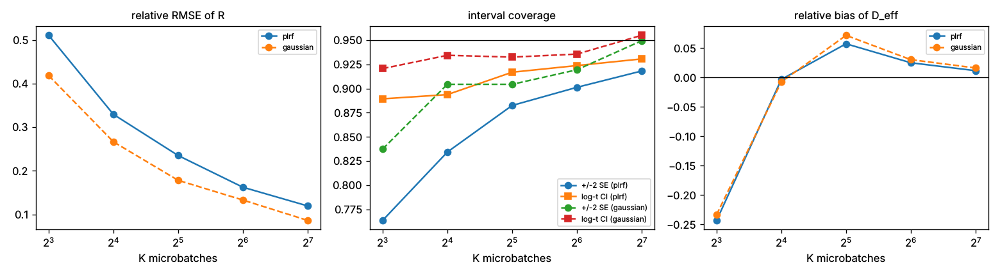
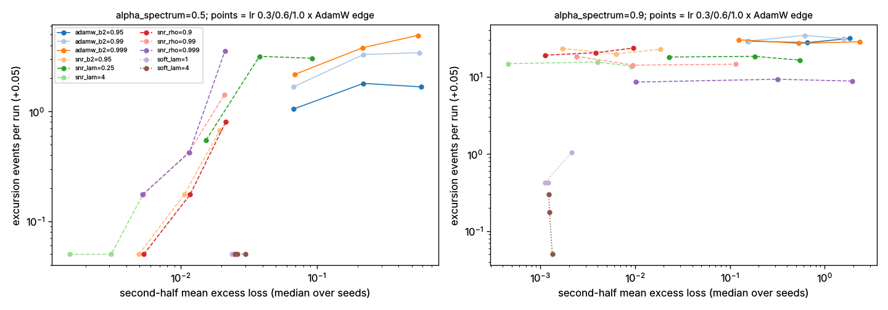
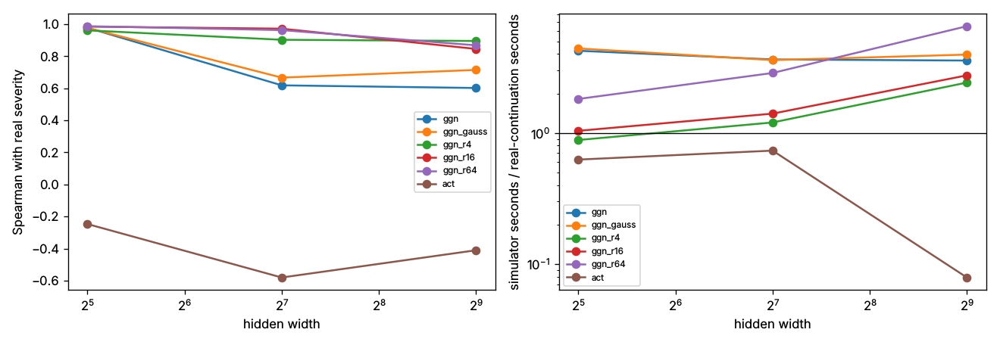
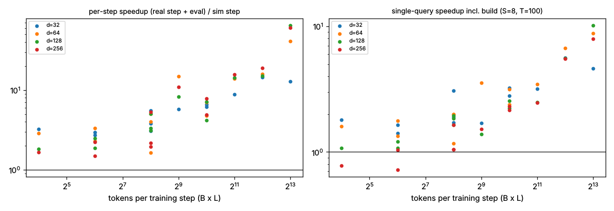
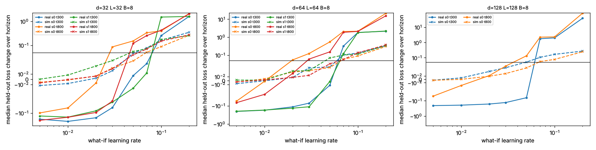

# Stability study: deeper tests of the curvature-aware stability sensor

A follow-up to [the proposal](../../docs/proposals/curvature-aware-stability-control.md)
and the first-round benchmarks (`benchmark_stability_plrf.py`,
`benchmark_stability_layers.py`). The first round left these questions open:

1. Does any noise-aware sensor add information beyond the sharpness baseline
   `lr * lambda_max(P H)`, which matched or beat the one-step sensors?
2. Is the gap a real limitation, or a quirk of a design where sharpness and noise vary
   together?
3. Why did the `R` standard errors cover the truth only 84% of the time?
4. Which simulator ingredients matter (noise model, horizon, seeds, probe size), and
   are its event *frequencies* calibrated, not just ranked?
5. Does SNR gating suppress spikes, delay them, or make them worse (proposal Stage 2)?
6. What happens with correlated data and with larger networks?

All scripts run from this directory with `uv run python <script> [--quick]` and write
JSON (and figures, via `plots.py`) to `results/`. Experiments E1-E5 use the PLRF problem
of `benchmark_stability_plrf.py` (D=256, V=4096, B=8 unless varied), where the Hessian
and gradient covariance are exact. Stability edges come from the first-round run.

## Summary

- **Noise-aware sensing matters, and it is decisive when noise varies at fixed
  sharpness (E1).** Varying only the batch size, the SGD sharpness is constant and
  cannot rank, while the noise penalty and the simulator reach Spearman 0.95-0.96.
  The overall picture is in E0 and E1 below.
- **Only the multi-step simulator survives Adam's coupling between noise and the
  preconditioner (E1).** For AdamW at the concentrated spectrum, spike severity *rises*
  with batch size (from 5.0 at B=2 to 8.4 at B=64). Every one-step sensor gets this
  wrong in at least one regime; the simulator, which replays Adam's second-moment
  dynamics, ranks correctly in all four (optimizer, spectrum) cells (0.66-0.96 with
  exact noise).
- **The simulator is well calibrated on PLRF (E3).** With true noise it reaches Spearman
  0.99 and an event-fraction error of 0.045. With noise resampled from 128 microbatches
  and loss-proportional scaling, it reaches 0.95-0.96, an error of 0.07-0.09 and no
  measurable bias. Loss-proportional scaling, enough microbatches (K >= 32), and 16 or
  more simulated seeds matter. Gaussian versus resampled noise matters less than the
  quick check suggested.
- **The probe's `R` is unbiased, but its jackknife SE is optimistic (E2).** The cause is
  right skew at small K, made worse by heavy-tailed noise. The new log-scale interval
  (`risk_trace_ci`) lifts coverage from 76-92% to 89-93%. The concentration estimate is
  usable from K=16, so the default minimum was relaxed.
- **SNR gating cuts both ways (E4).** At a moderately concentrated spectrum it removes
  most excursions *and* reaches a lower loss than AdamW at the same learning rate. At the most
  concentrated spectrum the default gate does not suppress spikes, and a slow variance
  EMA (`rho=0.999`) makes them rarer but enormous (maximum excursion about 5e4x). The
  soft gate nearly eliminates spikes there, at some cost in progress.
- **Correlated rows spread across microbatches make the probe blind to noise (E5).** It
  underestimates the variance by up to 100%. The library previously recommended exactly
  this (shuffling); it now provides `group_ids` to prevent it.
- **On networks, low-rank projected curvature is what works (E6).** The first run
  exposed a real pitfall: truncated curvature, including a GGN on fewer samples x
  outputs than parameters, makes the surrogate unbounded below, and rankings collapse
  or invert. With projection onto the top curvature subspace (now automatic for
  `LowRankCurvature`, with a warning otherwise), a rank 4-16 GGN ranks real severity at
  0.85-0.98 up to 284k parameters. The activation proxy fails at every width. A cost
  advantage over real continuations is still not demonstrated at these model sizes.

- **Scaling up (E7): cost stops being the issue at a few hundred tokens per step.** On a
  small Transformer LM, after optimising the simulator loop, the per-step speedup is
  about tokens-per-step / 200 at any width. A single what-if query pays off from about
  1k tokens per step (3.8-6.4x at 31k-430k parameters; 4.6-9.6x for 8 queries).
  - The simulator places the learning-rate instability onset within about 2x of reality
    (rank 64: geometric mean 0.85x, slightly conservative). Adam's edge-of-stability rule
    (threshold 3.8) never flags the unsafe rates in half the checkpoints and is otherwise
    about 3-4x too permissive.
  - It cannot predict how large a blow-up will be.
  - The noise-driven intermittent spikes the method targets barely occur at these sizes,
    so that part of the question needs larger models than this CPU budget allows.

- **When to expect a large spike effect (E8).** Closed-form indices predict PLRF spike
  severity almost perfectly: `Phi = kappa sqrt(2/D)` gives R^2 0.95 for SGD and AUROC
  0.97 for Adam. A spike window needs gradient noise aligned with the sharpest direction
  (`w >~ 0.1`).
  - Tiny Adam-trained LMs sit 30-300x below the spike band, and their noise is
    misaligned: Adam's whitening drops `w` by up to 270x (1.3-270x) below its SGD-geometry
    value.
  - Scaling trends do not close the gap, so look in SGD-trained, aligned settings rather
    than larger Adam LMs, and screen with `w` and `Phi` first.
  - Along the way: the E7 sharpness rule used the SGD threshold (2) instead of Adam's
    (3.8); corrected.

- **Adam from another angle: preconditioner memory (E9).** After a literature survey, we
  tested whether gradient noise protects Adam from second-moment (memory) spikes.
  - On a quadratic it does, completely, and the edge-oscillation amplitude follows a
    closed form within a constant factor of 20-50.
  - Tiny LMs on a *confident* language (no copy rule, temperature 0.03) produce the
    first large Adam spikes of this study: severity 2.3-24.5 in 5 of 5 seeds at
    `beta2 = 0.999`, against 1 of 5 at 0.95. The noise-protection index and every
    curvature sensor miss them.
  - The spikes are carried by a few converged bias vectors whose normalized update
    jumps from 0.03 lr to 3-5 lr. That overshoot is bounded by
    `A = max_k (1-beta1^k)/sqrt(1-beta2^k)` (6.6 at `beta2 = 0.999`, 1.1 at 0.95). At
    equal A, a high `beta1` keeps it far below the bound and prevents spikes.
  - The realized overshoot `max |m|/sqrt(v_hat)`, read for free from the optimizer
    state, separates spiking from quiet runs with AUROC 0.97.

- **Mitigation (E10).** Bounding Adam's per-coordinate update ratio at 1 (clipping it,
  or refilling `v_hat` where it would exceed 1) cuts spiking runs from 6 of 6 to 2 of 6
  and the largest severity from 24.5 to about 1, with no loss cost on either language.
  `beta1 = 0.98` (0 of 6) and `beta2 = 0.95` (1 of 6) also work. AMSGrad only partly
  helps (one spike of 19.4), and a larger `eps` on biases does not help at all.

- **Muon (E11).** On the E10 spiking setting, Muon on the hidden matrices (AdamW on the
  rest) left 1 of 6 runs with an event (severity 0.36) against 6 of 6 for AdamW, even
  though the AdamW half still overshot to 3.4-5.3 lr; guarding that half too left 0 of
  6. Muon's matrices have no second moment: every step sat at 1.20 times its nominal
  spectral size, the Newton-Schulz bound, while AdamW's steps on the same matrices
  reached 46-97 times it. Muon's own failure appeared at larger lr as cumulative growth
  (weight spectral norm 22 to 550-650, attention logits to about 6e5, loss 0.154 to
  0.19-0.24 at lr 0.3), which a per-step guard does not touch and weight decay bounds.

## E0 - incremental information beyond sharpness (`e0_incremental.py`)

Uses the first-round held-out checkpoints. It reports the partial Spearman correlation
with severity after controlling for `lr * lambda_max(P H)`, and the out-of-sample R^2 of
a log-severity regression fitted on dev seeds.

| group | sharpness R^2 | + exact-noise simulator | partial rho | + probe simulator | partial rho |
| --- | --- | --- | --- | --- | --- |
| pooled | 0.54 | 0.95 | +0.95 | 0.86 | +0.88 |
| SGD | 0.87 | 0.96 | +0.20 | 0.95 | +0.20 |
| AdamW | 0.97 | 0.98 | -0.05 | 0.98 | +0.12 |
| SNRAdamW | 0.64 | 0.92 | +0.92 | 0.86 | +0.79 |

Within plain SGD and AdamW, sharpness already explains almost everything in that design.
Across optimizers, and for the gated optimizer whose effective step depends on the gate,
the simulator adds a lot. The one-step ratios (`noise_to_loss`, `rel_sd`) add little or
nothing anywhere.

## E1 - decoupling sharpness from noise (`e1_decoupling.py`, `e1_breakdown.py`)

The grid is spectrum {0.5, 0.9} x {SGD, AdamW} x lr = 0.5 x edge x B {2, 4, 8, 16, 64} x
target exponent {0.5, 0.7, 1.0}, with 4 checkpoint seeds at 2 times each (576
checkpoints, 16 real continuations each). Each cell below is the mean within-stratum
Spearman with severity when **only B varies**:

| | sharpness | GNS (opt.) | noise penalty | noise/loss | probe simulator | exact simulator |
| --- | --- | --- | --- | --- | --- | --- |
| SGD, alpha 0.5 | n/a (constant) | -0.89 | **+0.96** | +0.52 | **+0.96** | **+0.96** |
| SGD, alpha 0.9 | n/a (constant) | -0.64 | **+0.95** | **+0.96** | **+0.94** | **+0.96** |
| AdamW, alpha 0.5 | -0.41 | -0.40 | +0.44 | -0.41 | +0.45 | +0.66 |
| AdamW, alpha 0.9 | +0.51 | -0.09 | -0.29 | +0.60 | +0.53 | +0.72 |

Mean severity by batch size (target exponent 0.7):

| | B=2 | 4 | 8 | 16 | 64 |
| --- | --- | --- | --- | --- | --- |
| SGD, alpha 0.5 | 11.9 | 2.0 | 0.65 | 0.28 | 0.07 |
| SGD, alpha 0.9 | 37.2 | 7.4 | 1.6 | 0.56 | 0.11 |
| AdamW, alpha 0.5 | 0.63 | 0.69 | 0.73 | 0.64 | 0.46 |
| AdamW, alpha 0.9 | 5.0 | 5.9 | 6.9 | 7.6 | 8.4 |

For SGD, larger batches cure spikes, as the `Sigma / B` picture predicts. For AdamW on the
concentrated spectrum, larger batches make spikes *worse*. A plausible mechanism is that
less noise shrinks the second moment and enlarges the effective step along the sharp
mode. So **"increase the batch size" is not a safe universal response to spike risk**,
and a batch controller built on a one-step sensor would get Adam wrong.

When only the target exponent varies, every noise sensor is weak (at most +0.29), and
sharpness (Adam strata only) scores +0.71. That axis changes severity little, so this is
mostly noise.

## E2 - estimator calibration (`e2_estimator_calibration.py`)

Setup: 200 repeated probes at each of 8 exact checkpoints (spectrum {0.5, 0.9} x
{SGD, AdamW} x 2 seeds; true `D_eff` between 1.2 and 3.7), using the true heavy-tailed
PLRF noise and a Gaussian control with the same covariance.

| K | R bias | R rel. RMSE (PLRF / Gauss) | +/-2 SE coverage | log-t CI coverage | D_eff bias (min dof 4) |
| --- | --- | --- | --- | --- | --- |
| 8 | +0.5% | 0.51 / 0.42 | 0.76 / 0.84 | 0.89 / 0.92 | -24% (abstains 62%) |
| 16 | -0.8% | 0.33 / 0.27 | 0.83 / 0.90 | 0.89 / 0.93 | -0.3% |
| 32 | +0.2% | 0.24 / 0.18 | 0.88 / 0.90 | 0.92 / 0.93 | +6% |
| 64 | -0.8% | 0.16 / 0.13 | 0.90 / 0.92 | 0.92 / 0.94 | +3% |
| 128 | -0.1% | 0.12 / 0.09 | 0.92 / 0.95 | 0.93 / 0.95 | +1% |

`R` is unbiased at every K. Undercoverage comes from the right skew of `R_hat`
(skewness 1.6 at K=8) and from heavy tails; the log-scale interval removes most of it.
At small K, PLRF noise costs about 20-25% more RMSE than Gaussian noise. Changes made:
added `risk_trace_ci`, and changed `min_concentration_dof` from 16 to 15 (K=16 is
unbiased; K=8 is not).

## E3 - simulator ablations and calibration (`e3_simulator.py`)

Setup: 72 checkpoints (4 spectra x {SGD, AdamW, SNRAdamW} x lr {0.3, 0.7, 0.95} x edge
x 2 seeds), each with 32 real continuations of 800 steps scored at prefixes 50 / 200 /
800. Columns: Spearman of severity, mean absolute error and bias of the simulated
event fraction, and the median log10 ratio of simulated to real severity.

| variant (horizon 200) | rho | event-fraction MAE | bias | log10 severity ratio |
| --- | --- | --- | --- | --- |
| oracle (true PLRF noise) | 0.991 | 0.048 | +0.003 | -0.03 |
| exact Sigma, loss-proportional | 0.972 | 0.083 | -0.046 | -0.04 |
| exact Sigma, fixed | 0.918 | 0.169 | -0.158 | -0.12 |
| resampled, K=128, loss-prop. | 0.951 | 0.094 | -0.011 | +0.01 |
| resampled, K=32, loss-prop. | 0.943 | 0.129 | -0.048 | +0.02 |
| Gaussian, K=32, loss-prop. | 0.950 | 0.102 | -0.062 | -0.03 |
| Gaussian, K=32, fixed | 0.907 | 0.155 | -0.142 | -0.11 |
| Student-t(5), K=32, loss-prop. | 0.954 | 0.128 | +0.097 | +0.20 |
| Gaussian, K=8, loss-prop. | 0.804 | 0.184 | -0.072 | -0.03 |

With 4 / 16 / 64 simulated seeds (exact, loss-proportional), rho is 0.955 / 0.972 /
0.982. Horizon has little effect on ranking. At 800 steps, resampled K=128 is the best
practical variant (rho 0.961, MAE 0.073, bias +0.016). The oracle result confirms that the
optimizer-state replay is correct. The remaining error is the noise model: it must
follow the loss (state dependence), and it needs enough microbatches to represent the
covariance.

## E4 - optimizer timescales and SNR gating (`e4_timescales.py`)

Setup: 11 variants on a *shared* learning-rate grid (0.3 / 0.6 / 1.0 x the AdamW edge),
8 seeds, 4000 steps.

- **alpha=0.5:** SNR gating with the default `snr` gate cuts excursions from 1.6-4.9 per
  run (AdamW) to 0-1.4 (0-3.5 for `rho=0.999`; 3.1 for `lambda_pop=0.25`), and reaches a 4-40x lower final loss. `lambda_pop=4` is best on
  both counts (0-0.1 events per run, lowest loss). The soft gate has zero events but
  learns more slowly (it never reaches the common loss target).
- **alpha=0.9:** AdamW has about 30 events per run whatever `beta2` is. The `snr` gate
  still has 9-24, so it does **not** suppress spikes there. A slow variance EMA
  (`rho=0.999`) makes events rarer (about 9 per run) but much larger: the median maximum
  excursion is 1.8e3 to 5.5e4x the trailing baseline, versus 20-50x for AdamW. That is
  the "misidentified signal under stale moment estimates" failure the proposal
  anticipated. The **soft gate nearly eliminates spikes** (0-1 per run) at a final
  excess loss about 3-6x that of `snr` with `lambda_pop=4`.
- **AdamW `beta2`** (0.95 / 0.99 / 0.999) has no consistent effect on spike counts here.
  The paper's `beta2` recipe does not carry over to this setting as a general rule.

## E5 - correlated examples (`e5_correlated_data.py`)

Setup: each distinct example appears r times in a batch of 64. The table shows the
estimated / true variance of the batch-mean gradient for a K=8 probe.

| r | grouped split | interleaved split |
| --- | --- | --- |
| 1 | 1.00 | 1.00 |
| 2 | 0.98 | 0.43 |
| 4 | 0.95 | 0.14 |
| 8 | 1.03 | 0.00 |

Keeping correlated rows in one microbatch gives the right batch noise (counting groups
as the units gives the right per-example covariance). Spreading them across
microbatches hides the noise. `collect_microbatch_gradients` now takes `group_ids` and
refuses splits that would cut a group.

## E6 - network scale and low-rank curvature (`e6_network_scale.py`)

Setup: teacher-student MLP regression at hidden widths 32 / 128 / 512 (2.4k / 22k / 284k
parameters), with 6 optimizer and learning-rate arms x 2 seeds x 2 checkpoints. Each
checkpoint has 8 real continuations and 8 simulated ones, 100 steps each. Noise is
resampled from K=32 microbatches with loss-proportional scaling. The GGN is computed on 256
held-out samples (8 outputs).

| simulator curvature | rho, width 32 | rho, width 128 | rho, width 512 | cost vs real, width 32 / 128 / 512 |
| --- | --- | --- | --- | --- |
| full GGN | 0.98 | 0.62 | 0.60 | 4.2x / 3.7x / 3.6x |
| low-rank GGN, r=4 | 0.96 | 0.90 | **0.90** | 0.9x / 1.2x / 2.4x |
| low-rank GGN, r=16 | **0.98** | **0.97** | 0.85 | 1.0x / 1.4x / 2.8x |
| low-rank GGN, r=64 | 0.99 | 0.96 | 0.87 | 1.8x / 2.9x / 6.5x |
| activation proxy | -0.25 | -0.58 | -0.41 | 0.6x / 0.7x / 0.1x |

**A pitfall the first run exposed.** Before the subspace fix, the low-rank variants had
rank correlations of -0.58 to +0.22
(`results/e6_network_scale_before_subspace_fix.json`). With truncated curvature, `g0` keeps components that have
almost no restoring force, so the surrogate loss falls without bound. On one checkpoint
it went from 0.06 to -1.08. Projecting `g0` and the noise onto the curvature's
eigenvector span fixes this; it is now automatic for `LowRankCurvature`.

**The full GGN suffers from the same problem (`e6b_full_ggn_projection.py`).** A GGN on
256 samples x 8 outputs has rank at most 2048, which is below the parameter count at
widths 128 and 512. At width 512, the unprojected full-GGN surrogate falls to -2.2x and
-16x the starting loss in the two spiky AdamW arms, and its simulated severity collapses
(0.23 against a real 2.30). Projecting onto its top-64 eigenvectors gives 2.17 vs 2.30
and 1.48 vs 1.53. The Spearman across the 6 arms goes from 0.66 to 1.00, though n is
small. The simulator now warns whenever the noiseless surrogate path goes below zero
for a non-negative loss.

Takeaways:

- With projection, a **rank 4-16 GGN keeps the ranking at 0.85-0.98** up to 284k
  parameters. The top few curvature directions carry the excursions.
- The **activation proxy is not usable for simulation**: it is anti-correlated at every
  width.
- **Cost has not been shown to be a win.** On these tiny models a real training step
  takes 1-2.5 ms, so real continuations are cheap, and the simulator (which still runs
  the optimizer over all parameters, plus the GGN build) costs 1-3x as much. The case
  for the simulator rests on models where a real step costs far more than an optimizer
  update plus a rank-r product. These experiments do not test that.

## E7 - scaling up: where does the simulator pay off? (`e7_*.py`, `tinylm.py`)

The question: what is the smallest scale at which the checkpoint simulator is
cheaper than simply running real continuations, while still telling which
configurations are unsafe? The test model is a small decoder-only Transformer
(`tinylm.py`: explicit causal attention, so `torch.func` JVPs work) trained with AdamW
on a synthetic language (an order-1 Zipf-like Markov chain plus a copy-8-back rule).
Each row is one sequence, so microbatches never split correlated tokens (E5).

**Simulator speed (library change).** The per-step loop was rewritten: flat parameter
and gradient buffers, noise pre-projected into subspace coordinates, and a fused
rank-r path for `LowRankCurvature` that makes two passes over `V` per step. A simulated
step went from 15x a bare AdamW step to 2.6x (n = 1M, r = 16). A test checks that the
fused path reproduces the generic one to 1e-9.

**Cost crossover (`e7_crossover_timing.py`, 96 configurations, 4 CPU threads).** Width
is 32-256, depth 2-4, sequence length 8-256, batch 2-32. A query is 8 continuations x
100 steps, including a held-out loss evaluation per real step. The simulator build is
the probe (32 microbatches) plus a rank-16 GGN on 16 held-out sequences.

- Fitted cost model (R^2 0.95): real step = 11 ms + 36 ps x params x tokens; simulated
  step = 1.8 ms + 6.9 ns x params. **The per-step speedup is about tokens-per-step / 200**:
  the simulator wins per step once a training step processes more than about 200
  tokens, at any width.
- Single-query speedup including the build: median 2.0x, range 0.5-10x. It is below 1
  only for tiny batches with comparatively large models (B=2, or L=8 at width >= 128),
  where the GGN build dominates. With 5 queries from one build, nearly all
  configurations win.
- So **cost is not the binding constraint**. The crossover is at a few hundred tokens
  per step. Real LM training (1e5-1e6 tokens per step) is about three orders of
  magnitude past it, with a predicted per-step speedup in the thousands.

**Is the targeted effect present at this scale? (`e7_lr_scan.py`).** Mostly not.
- Across learning rates 0.005-0.6, `beta2` 0.95 and 0.999, batches 2-32 and widths
  32-64, raising the learning rate makes training *stall* smoothly at a higher loss.
  Intermittent excursions appear only weakly: 0.3-0.7 events per 1500-step run, of
  25-37% size, at lr about 0.05 with B = 4-8.
- An earlier attempt with an order-2 Markov language never learned (loss stayed at
  ln 64), and its results were discarded.

The question that remains testable, and is the one a controller would ask, is **"which
learning rates are unsafe from this checkpoint?"**

**What-if queries (`e7_whatif.py`).** Setup: AdamW at lr = 0.01, checkpoints at steps
300 and 800. From each checkpoint, 8 candidate learning rates (0.005-0.2) are each run
with 8 real continuations of 300 steps, and also answered by **one** simulator build per
checkpoint (rank-16 GGN, resampled loss-proportional noise). "Unsafe" means the held-out
loss rises by more than 0.05 nats over the horizon. Sharpness is `lr * lambda_max(P H)`
on the same low-rank GGN, including the `(1 - beta1)` one-step factor. In those units
Adam's edge-of-stability threshold is `2 (1 + beta1) = 3.8` (Cohen et al. 2022; see
`docs/stability-theory.md`). **Correction:** the first version of this section used
threshold 2, which is the SGD value. Both are shown below.

| model | params | severity rho (sim / sharpness) | unsafe accuracy (sim / sharpness > 3.8 / > 2) | speedup (8 queries / 1 query) |
| --- | --- | --- | --- | --- |
| d=32, L=32, B=8 | 31k | 0.93 / 0.97 | **0.81** / 0.59 / 0.72 | 4.6x / 3.8x |
| d=64, L=64, B=8 | 112k | 0.98 / 0.97 | **0.81** / 0.53 / 0.63 | 6.7x / 5.2x |
| d=128, L=128, B=8 | 430k | 0.97 / 0.97 | **0.88** / 0.69 / 0.88 | 9.6x / 6.4x |

Onset ratio (predicted / real smallest unsafe learning rate) per checkpoint. "never"
means no tested learning rate (up to 0.2) was flagged:

| model | simulator, rank 16 | sharpness > 3.8 (correct) | sharpness > 2 |
| --- | --- | --- | --- |
| d=32 | 0.7, 2.3, 0.5, 1.4 | never (x4) | 2.0, 6.7, 2.0, 4.0 |
| d=64 | 1.0, 3.5, 0.7, 2.3 | 2.9, never, 2.9, never | 2.9, 10, 1.4, 6.7 |
| d=128 | 0.7, 1.4 | 2.9, 4.0 | 1.0, 2.0 |

- Within one checkpoint, sharpness is just proportional to the learning rate, so any
  monotone score ranks the queries. The ranking columns therefore do not discriminate;
  the absolute decision does.
- **The simulator places the instability onset within about 2x of reality; the
  edge-of-stability rule does not.** With the correct threshold the rule never flags
  any tested learning rate in 5 of the 10 checkpoints, and is otherwise 2.9-4x too
  permissive. The real instabilities here happen far below the deterministic adaptive
  edge, which is the gap that noise-aware simulation fills.
- **The simulator cannot predict magnitudes.** Real blow-ups raise the loss by 2 to 80
  nats; the quadratic surrogate tops out at about 0.3. It also misses continued learning
  at small learning rates (real loss falls by up to 0.2; simulated stays about flat),
  because the rank-16 projection discards most descent directions. It is an onset
  detector, not a forecaster.

**Rank ablation (`e7_rank_ablation.py`, d=64, same checkpoints).** The simulator was
optimistic late in training. Higher curvature rank fixes most of that:

| GGN rank | onset ratios (4 checkpoints) | geometric mean | build + 8 queries |
| --- | --- | --- | --- |
| 4 | 1.4, 10, 2.9, 6.7 | 3.6 (optimistic) | about 67 s |
| 16 | 1.0, 3.5, 0.7, 2.3 | 1.6 | about 52 s |
| 64 | 0.43, 1.5, 0.43, 1.7 | 0.85 (slightly conservative) | about 72 s |

For comparison, the 8 real queries take about 340 s per checkpoint. **Rank 64 gives the
best safety profile** (worst case 2.3x either way) and stays 4-5x cheaper here.

**Where the critical point is.**
- **Cost:** about 200 tokens per step for per-step parity. A single query pays off from
  roughly 1k tokens per step (or 5 queries per build), at every width tested.
- **Usefulness:** in this model family the simulator beats the (correctly thresholded)
  edge-of-stability rule at every size tested (31k-430k parameters).
- **Not reached:** the regime the proposal targets, with noise-driven intermittent spikes
  at a fixed learning rate, does not appear clearly in models this small. Testing it
  needs larger models or longer training than this CPU budget allows. The prediction from
  E1 (Adam spike severity *rising* with batch size on concentrated spectra) has not been
  checked on a Transformer.

## E8 - when should a large spike effect appear? Theory plus small runs (`e8_*.py`)

Derivations are in [`docs/stability-theory.md`](../../docs/stability-theory.md); the code
is in `snr_grad.stability_theory`. Four closed-form quantities, each checked here:

| quantity | meaning |
| --- | --- |
| `kappa` | SGD feedback gain: the noise-driven fraction of the stationary loss (exact for Gaussian design); the mean loss diverges at 1 |
| `D_K` / `D_hat` | number of curvature modes carrying that noise-driven loss |
| `Phi = kappa sqrt(2/D)` | predicted relative fluctuation of the loss |
| `w` | share of gradient noise along the sharpest (preconditioned) direction: the relative width of the learning-rate window in which large noise-driven spikes are possible |

Adam enters through its preconditioner `P = 1/sqrt(v)` and its momentum edge
`2(1+beta1)/(1-beta1) = 38`.

**E8a - PLRF validation (exact H and Sigma; `e8_plrf_theory.py`, `e8_sgd_indices.py`,
`e8_adam_indices.py`).**
- **SGD (60 configurations).** The closed-form expected loss matches the seed-averaged
  runs to about three digits wherever `kappa < 1` (for example 0.3187 vs 0.3185).
  - Log severity is explained by `Phi` (R^2 0.95) and by the Kesten tail exponent `xi`
    (R^2 0.97); jointly R^2 = 0.99.
  - Phase diagram: `kappa >= 1` diverges unless the feedback is single-mode
    (`D_K <= 1.4`). In that case it gives infinite-mean bursts instead: severity
    3000-4000 with no divergence.
- **Adam (288 checkpoints).** In Adam-preconditioned coordinates, `Phi` predicts whether
  the next 1000 steps contain a severe excursion with AUROC 0.97 (log-severity R^2 0.86),
  against 0.81 (R^2 0.43) for the adaptive edge ratio.
  - Calibration: `severity ~ 15 * Phi^1.38`, so a 100% excursion corresponds to
    `Phi ~ 0.14` and a 10x one to `Phi ~ 0.7`.
  - The edge ratio rises with batch size (`v` shrinks), which explains E1's
    "bigger batch, worse Adam spikes".

**E8b - the tiny LM is far from that band (`e8_lm_indices.py`, `e8_lm_trend.py`,
`e8_lm_data.py`, `e8_lm_favorable.py`, `e8_lm_scaling.py`).** The same indices were
measured at about 130 LM checkpoints: width 32-256, batch 8-128, sequence 16-256, lr 0.003-0.03,
up to 4000 steps, and vocabularies of 64-4096 tokens with or without Zipf frequencies.

- **Standard settings:** `Phi = 0.0005-0.005`, 30-300x below the band. Two factors keep
  it small:
  - only 1-10% of the loss is noise-driven (`kappa_hat`);
  - that part is spread over `D_hat` = 100-6000 modes.
- **Fit** (R^2 0.91): `Phi ~ d^0.36 B^-0.39 L^-0.44 lr^0.52`. At lr 0.01, `Phi` reaches 0.15
  only at widths of order 1e7-1e8, so width alone will not get there.
- **Raising the learning rate does not help.** Above Adam's edge (ratio 2-950 here), runs
  *stall* rather than spike.
- **Longer training does not help.** `D_hat` falls 3-7x over 4000 steps, but
  `kappa_hat` falls in step, so `Phi` stays flat.
- **Data:** heavy Zipf frequencies at a small vocabulary halve `D_hat` (`Phi` x2), but
  larger vocabularies spread the noise over more embedding rows (`Phi` falls).
- **Most favourable corner** (width 256, B = 2-4, L = 16, Zipf): `D_hat` = 8-43 and
  `Phi` = 0.004-0.02, within about 2x of the fit. Observed severity was 0.03-0.07,
  matching the PLRF calibration (0.026-0.07). That corner also stalls easily.

**E8c - why: the noise is not aligned with the sharpest direction (`e8_window.py`,
`e8_alignment.py`).**
- **PLRF:** `w = lambda_1 / tr(H)` correctly separates the spike-capable spectra (w >= 0.12)
  from the diffuse one (w = 0.02, which diverges without spiking). It does not locate
  the onset precisely; batch size shifts it.
- **LM, Adam geometry:** `w = 1e-4 to 7e-3`, below even the non-spiking PLRF case.
- **LM, SGD geometry, same Adam-trained checkpoints:** `w` is up to 270x higher, reaching
  0.10-0.16 for the favourable configuration. So **Adam's per-coordinate whitening
  removes the alignment** that noise-driven spikes need.

**E8d - targeted test with SGD (`e8_sgd_lm_test.py`, `e8_sgd_lm_phi.py`).** The theory
predicted that the favourable configuration should show spikes under plain SGD near its
edge, while the control (w ~ 0.01) should not.
- **Result:** the aligned configuration's excursions are 2-4x larger than the control's
  (median severity 0.07-0.09, maximum 0.23, against 0.02-0.04). No event crosses the
  25% threshold, and there is no growth toward the edge.
- **Explanation:** when *trained* with SGD, the configuration's `w` is only 0.036. The
  geometry differs from the Adam-trained checkpoint, and 0.036 is below the
  spike-capable range, so no spikes is consistent with the theory.
- `Phi` predicted the observed severity within about 1-8x. The Kesten heavy-tail term
  over-predicted by orders of magnitude: it needs noise proportional to the error along
  the sharp mode, which does not hold here.

**Estimate: when is a big spike effect worth testing?**

A configuration qualifies only if, in the optimizer's own geometry and below its edge,
`w >~ 0.1`, `Phi >~ 0.15`, and either `kappa < 1` or `D ~ 1`. The tiny LMs miss on every
count:
- **Adam:** `w` is 15-1000x too small and `Phi` 7-300x too small.
- **Trends with scale:** `w` falls with width and vocabulary; `Phi` grows only as
  `d^0.36`.
- **Conclusion:** **scaling up a standard Adam-trained LM is not a path to the noise-driven
  spikes the proposal targets.** Spikes seen in large Adam LMs are more likely other
  mechanisms (in this study, crossing the adaptive edge produced stalls); the current
  theory does not cover those.

Where to look instead:
- **SGD or momentum training** of models whose sharpest direction is also their noisiest:
  PLRF-like random-feature or linear-head models, or tasks with a dominant output
  direction.
- **Screen first:** measure `w`, `Phi` and `kappa` at a few checkpoints before
  committing to an expensive run. That costs seconds to minutes per checkpoint on these
  models.

## E9 - Adam from another angle: preconditioner memory and the noise floor (`e9_*.py`)

E8 asked when *noise-driven* spikes get large and found that Adam's whitening keeps
them small in tiny LMs. A literature survey
([`docs/adam-spikes-literature.md`](../../docs/adam-spikes-literature.md)) points to a
different, Adam-specific mechanism: the second-moment memory `v_hat` decays when the
gradients it sees fall below what it remembers, the effective step `lr/sqrt(v_hat)`
grows, and the run crosses Adam's adaptive edge (`lr * lambda_max(P H) = 38` for
`beta1 = 0.9`). The gradient then grows, refills `v_hat`, and the run recovers: a spike.
Reported risk factors are a large `beta2`, large batches, confident (low-loss)
cross-entropy, and small `eps`.

The new angle: **gradient noise puts a floor under that decay**, `v >= mu^2 + sigma^2/B`,
so noise should *protect* Adam. Three checkpoint quantities follow
(`snr_grad.adam_memory_forecast`, `snr_grad.adam_edge_amplitude`):

| quantity | meaning |
| --- | --- |
| `R_act = lr * lambda_max(P^1/2 H P^1/2) / 38` | current distance to Adam's edge, with the actual `P = 1/sqrt(v_hat)` |
| `R_floor` | the same with the noise-floor preconditioner `1/(sigma/sqrt(B))`: the closest the memory can bring the run to the edge. Below 1 the run is protected. Since `R_floor ~ sqrt(B)`, protection is lost above `B_crit = B / R_floor^2` |
| `Delta L_edge = lr^2 h_w / (2 * 38^2 * max_i P_i u_i^2)` | loss scale of an oscillation at the edge: the gradient must refill `sqrt(v)` to about `lr h / 38` along the top whitened direction `u` |

**E9a - noisy quadratic (`e9_noisy_quadratic.py`).** Adam on `L = h x^2/2` with
gradient noise of standard deviation `s = lr / (38 R_floor)`, 16 seeds, late-phase
statistics (second half of 8000 steps; 30000 for `beta2 = 0.999`).

| R_floor | 0.25 | 0.5 | 1 | 2 | 4 | 16 | no noise |
| --- | --- | --- | --- | --- | --- | --- | --- |
| median `lr h / sqrt(v_hat)` (`beta2` 0.99) | 4.9 | 7.9 | 12.1 | 18.0 | 24.8 | 34.7 | 36.3-36.7 |
| peak loss / `(lr^2 h / 2888)` (`beta2` 0.99) | 558 | 264 | 109 | 54 | 26 | 17-20 | 19-22 |

- The effective step follows the floor smoothly (about `38 R_floor / (R_floor + 2)`;
  an empirical fit) and pins just below the edge once the noise is weak. The values are
  identical at lr 0.003, 0.01 and 0.03, as the scaling predicts.
- With noise, the late loss is the ordinary stationary noise ball: a peak about 27-33x
  its median at every `R_floor`, with no intermittent bursts.
- Without noise, `beta2 = 0.99` sits at the edge with peak losses about 20x the
  amplitude scale `lr^2 h / 2888`.
- **Without noise and with `beta2 = 0.999`, the memory spikes of Bai et al. appear:**
  the loss falls to about 1e-18 between bursts that reach 1.3e-5 (about 1e13x the
  median). Any of the noise levels tested (`R_floor <= 16`) removes them completely.
  So the protection effect is real and strong on the quadratic.

**E9a-2 - amplitude in many dimensions (`e9_amplitude.py`).** Rotated quadratics in 20
dimensions (log-spaced spectrum over two decades), with and without weak noise, at lr
0.003-0.03. The observed late peak loss is 38-47x `Delta L_edge` for a random rotation
and 25-27x when the top direction is spread evenly over all coordinates. The ratio is
constant across a 100x range of `lr^2`. For the delocalized case the formula predicts
20x (that is, `d` times) the one-dimensional scale, and the observed peaks are about 25x
that prediction, as in one dimension. So **edge oscillations cost
about 20-50 `Delta L_edge`**, and a relative spike size is predicted by
`S = 30 Delta L_edge / L`.

**E9b - tiny LM, E7/E8 language at lower temperature (`e9_lm_confident.py`).** Width
64, sequence 32, 3000 AdamW steps; temperature 0.5, 0.1 and 0.03 (lower is more
deterministic) x B in {4, 32} x `beta2` in {0.95, 0.999} x lr in {0.003, 0.01}, one seed
each. The indices above were measured at steps 1000 and 2000 with a rank-4
preconditioned GGN.
- **No events in 24 runs**: severity 0.01-0.14. Lower temperature raises it slightly
  (maxima 0.03, 0.12, 0.14), and B = 4 is noisier than B = 32.
- **Adam sits on its noise floor and far from its edge.** `R_act` = 0.008-0.15, and
  `R_act / R_floor` = 0.55-1.1. Here `v_hat` has already decayed to the gradient noise,
  as the protection argument assumes. The predicted relative edge amplitude `S` is
  below 4e-4.
- The copy rule (probability 0.3) leaves an ambiguity the model cannot resolve, so the
  loss stays at 0.31-0.37 nats at temperature 0.03, well above the 0.016 nats of the
  Markov part. This language never becomes confident.
- A first run estimated the per-sequence variance from single-sequence microbatches
  at B = 4. That gave zero variance to rarely touched embedding rows and inflated
  `R_floor` to 3-11. The variance now comes from 8-sequence microbatches at every B;
  the numbers above use the corrected estimator.

**E9c - a confident language: the first Adam spikes in a tiny LM (`e9_lm_confident.py
--grid clean`, `e9_lm_repeat.py`).** Removing the copy rule at temperature 0.03 (entropy
floor 0.023 nats; the runs plateau near 0.153) and adding B = 128:

| B | `beta2` | lr | runs with an event | severity (per seed) | `R_act` at step 2000 | `R_floor` at step 2000 |
| --- | --- | --- | --- | --- | --- | --- |
| 4 | 0.95 / 0.999 | 0.003-0.01 | 1 of 4 | 0.11-0.42 | 0.014-0.025 | 0.016-0.056 |
| 32 | 0.95 | 0.01 | 1 of 5 | 0.09-2.20 | 0.03-0.42 | 0.06-0.43 |
| 32 | 0.999 | 0.01 | **5 of 5** | **2.3, 3.0, 3.2, 4.9, 24.5** | 0.05-0.09 | 0.20-0.55 |
| 128 | 0.999 | 0.01 | 2 of 4 | 0.05-9.5 | 0.12-0.13 | 1.4-6.6 |
| 128 | 0.95 | 0.01 | 0 of 1 | 0.16 | 0.67 | 1.7 |
| 32 / 128 | 0.95 / 0.999 | 0.003 | 0 of 4 | 0.02-0.17 | 0.03-0.10 | 0.04-0.52 |

- These are real, isolated spikes: the held-out loss jumps up to 25x for fewer than 10
  steps and then returns to its previous level.
- **`beta2 = 0.999` is the main risk factor** (5 of 5 against 1 of 5 at B = 32), as the
  literature reports. A larger lr also matters.
- **The noise-protection prediction fails here.** At B = 32 the spikes occur with
  `R_floor` 0.2-0.55, where the run should be protected, while B = 128 with
  `beta2 = 0.95` has `R_floor` 1.7 and does not spike. The curvature sensor does not
  see the spikes either: the measured edge ratio is only 0.05-0.13.
- A rerun of the spiking seed without the index measurements (which changes the
  trajectory slightly) also spikes, with severity 13 at step 1915. So the probe does not
  cause the spikes.

**E9d - mechanism (`e9_lm_diagnose.py`).** Per step we recorded the largest normalized
update `max_i |Delta theta_i| / lr` of every parameter tensor. A natural guess was that
the 60 tokens appearing only as the random first token have intermittently updated
embedding rows. That guess is wrong:
- Starting sequences inside the chain, so that those tokens never occur, still
  spikes in 5 of 5 seeds (severity 0.5-29).
- Giving the token embedding `beta2 = 0.95` still spikes in 3 of 5 seeds (2.0-32).

What changes before each spike is the **bias vectors of the first block** (attention
projection, MLP output, QKV, layer-norm biases). Their normalized updates jump from a
median of 0.03 lr to 3-5 lr. These coordinates converge early, their gradients and
gradient noise vanish, and `v_hat` (which remembers the larger early gradients) slowly
follows. When a gradient returns, `m / sqrt(v_hat)` overshoots. That is the Bai et al.
mechanism, carried by a small set of converged coordinates rather than by the
curvature-dominant direction.

How far can it overshoot? A coordinate whose memory has decayed, and whose gradient
returns steadily, steps at most

    A(beta1, beta2) = max_k (1 - beta1^k) / sqrt(1 - beta2^k)   ~ 0.8 sqrt((1 - beta1) / (1 - beta2))

times lr (`snr_grad.adam_reactivation_gain`; checked against PyTorch Adam in the
tests). A is 1.1 for `beta2 = 0.95`, 2.1 for 0.99 and 6.6 for 0.999, and it depends on
`(1-beta2)/(1-beta1)`, the variable of the empirical spike phase diagram. Observed
overshoots respect the bound: at most 5.9 lr at A = 6.6, and at most 1.06 at A = 1.1,
where no run spiked.

**E9e - dose response in (beta1, beta2) (`e9_lm_diagnose.py`, 5 seeds each).**

| (beta1, beta2) | A | runs with an event | severity >= 1 | largest overshoot / lr (after step 500, or before the peak where marked "window") |
| --- | --- | --- | --- | --- |
| (0.9, 0.95) | 1.1 | 0 | 0 | 1.0-1.1 (window) |
| (0.99, 0.999) | 2.1 | 0 | 0 | 0.3-0.7 |
| (0.9, 0.99) | 2.1 | 2 | 1 (16.2) | 2.0-2.2 |
| (0.98, 0.999) | 2.9 | 0 | 0 | 0.7-1.0 |
| (0.9, 0.995) | 3.0 | 2 | 0 | 2.6-2.8 |
| (0.95, 0.999) | 4.6 | 2 | 0 | 1.6-3.3 |
| (0.9, 0.999) | 6.6 | 5 (+5 stationary, +3 of 5 embed_b2) | 4 | 4.5-5.5 (window) |

- **A is an upper bound, not a predictor.** The pairs with equal A separate cleanly: at
  `beta1 = 0.9` the realized overshoot reaches the bound and runs spike, while at
  `beta1 = 0.98-0.99` it stays at 0.3-1.0 lr and no run spikes. A high `beta1` needs
  the returning gradient to stay coherent for about `1/(1-beta1)` steps before `m`
  builds up, and here it does not. This matches the reported mitigation "raise
  `beta1`".
- **The realized overshoot is the useful signal.** Across all 45 runs, the largest
  normalized update in the 60 steps before the loss peak separates runs with an
  event (severity >= 0.25) from the others with AUROC 0.97 (0.975 for severity >= 1).
  - All 21 runs below 1.85 lr had no event; all 13 runs above 3.5 lr had one.
  - It leads the loss by tens to about 150 steps in the two runs inspected in detail
    (`results/e9_reactivation.png`, right).
  - It is not specific in time: in the (0.9, 0.99) run it came within 15% of A several
    times without a spike.
- This signal is free: it is `max |m / (sqrt(v_hat) + eps)|` per tensor, read from the
  optimizer state with no probe and no curvature.

**Verdict on E9.** The literature angle was right that Adam spikes are a memory effect,
and the tiny LM reproduces them once the targets are confident and `beta2` is large.
The specific E9 prediction, protection by gradient noise (`R_floor < 1`), holds on the
quadratic but fails in the network: the coordinates that carry the spikes are a small
set of converged biases whose gradient *and* gradient noise vanish. A tensor-level
noise floor is not visible in the network-level `R_floor`. The curvature-based
sensors of this project (edge ratio, `Phi`, the simulator built on them) are blind to
this mechanism; the overshoot `max |m|/sqrt(v_hat)` per tensor, bounded by
`A(beta1, beta2)`, is the variable to watch for Adam.

## E10 - mitigating the Adam memory spikes (`e10_mitigation.py`)

**Settings.**
- Spiking setting: the E9c configuration (confident language, B = 32, lr = 0.01,
  `(beta1, beta2) = (0.9, 0.999)`, 3000 steps), with 6 seeds per variant. All variants
  use the same seeds and data order.
- Progress check: the standard E7/E8 language (temperature 0.5, copy rule 0.3), where
  nothing spikes, with 2 seeds per variant.
- "Overshoot" is the largest `|Delta theta| / lr` over all coordinates after step 500.
- "Late loss" is the median held-out loss over steps 2000-3000. For AdamW it is 0.1548
  on the confident language and 1.680 on the standard one.
- The guarded optimizer with no limit reproduces torch Adam (difference 2e-16).

| variant | runs with an event | severity >= 1 | largest severity | late loss, paired change vs AdamW | standard language: late loss change | overshoot |
| --- | --- | --- | --- | --- | --- | --- |
| AdamW (baseline) | 6 of 6 | 6 | 24.5 (median 4.1) | - | - | 5.1-6.0 |
| **cap**: clip `|m_hat|/(sqrt(v_hat)+eps)` at 1 per coordinate | 2 of 6 | 1 | 1.3 | -0.0004 | +0.0001 | 1.0 |
| **refill**: where that ratio exceeds 1, raise `v_hat` to make it 1 | 2 of 6 | 0 | 0.9 | -0.0006 | -0.0004 | 1.0 |
| AMSGrad (`v_hat` never decreases) | 2 of 6 | 2 | 19.4 | -0.0005 | -0.0050 | 2.0-5.7 |
| `eps = 1e-4` on 1-D parameters | 5 of 6 | 5 | 14.0 | -0.0002 | +0.0009 | 4.5-6.0 |
| `eps = 1e-5` on 1-D parameters | 5 of 6 | 5 | 14.1 | -0.0003 | +0.0004 | 3.4-5.9 |
| `beta1 = 0.98` | **0 of 6** | 0 | 0.07 | -0.0008 | +0.0012 | 0.7-1.1 |
| `beta2 = 0.95` | 1 of 6 | 1 | 2.2 | -0.0014 | -0.0022 | 1.1 |

- **Limiting the per-coordinate update ratio removes the large spikes at no cost.**
  - The cap and the refill both bound the overshoot at 1 lr.
  - The remaining events are small (severity 0.26-1.3).
  - The loss is unchanged on both languages (all changes within 0.001 nats).
  - The refill is slightly stronger, because it also corrects the stale memory for the
    following steps.
  - This is a per-coordinate form of the update clipping used in Adafactor and
    StableAdamW, which clip the RMS of the update per tensor.
- **`beta1 = 0.98` (0 of 6) and `beta2 = 0.95` (1 of 6) also work,** as E9e predicted.
  `beta1 = 0.98` is slightly slower early on the standard language (loss at step 1000:
  1.720 vs 1.710).
- **AMSGrad helps only partly** (2 of 6, one of severity 19.4). Keeping the maximum
  `v_hat` stops the memory from decaying. It does not bound the step when a gradient
  larger than anything remembered arrives, and the overshoot still reached 5.7.
- **`eps` on the biases and layer norms does not help,** even at the scale of their
  typical `sqrt(v_hat)` (about 1e-4). Overshoots of 3-6 lr persist, so the stale
  coordinates are not only the 1-D parameters that E9d's per-tensor diagnostic
  highlighted.
- **Correction to E9: spikes do not strictly require an overshoot.**
  - One `beta2 = 0.95` run reached severity 2.2 with a largest update of 1.08 lr, and a
    capped run reached 1.3.
  - Large overshoots remain the signature of the large spikes: every event above
    severity 3 had an overshoot of at least 3.7 lr.
  - Smaller events can come from another mechanism.

**Library form.** The refill guard is now `snr_grad.GuardedOptimizer` (with `MemoryGuard`
for the external form and `adam_update_overshoot` as the monitor). It wraps any
Adam-family optimizer, clips each coordinate's step after the base step, and refills
`v_hat` from the post-step state. Run as the `library` variant of `e10_mitigation.py`
around torch AdamW with default settings:
- **Spiking setting:** 1 of 6 runs with an event (largest severity 0.43); the late loss
  was unchanged.
- **Standard language:** late loss 1.680, the same as AdamW.
- The study's own refill gave 2 of 6 (at most 0.9). The two agree to the stored
  precision for the first 1200 steps; float32 rounding then separates the trajectories.

**Verdict.** On this setting, a one-line change to Adam removes the memory spikes with
no measurable cost: bound the per-coordinate update ratio, preferably by refilling
`v_hat`. Changing `beta1` or `beta2` does nearly as well, but it changes the optimizer
everywhere, while the guard acts only on coordinates whose memory is stale. These are
small models with 6 seeds per variant, so a test at a larger scale should come before
treating this as a general recommendation.

## E11 - Muon: no memory spikes, cumulative growth instead (`e11_muon.py`)

Question: does Muon have the memory spikes of E9/E10, and what should
`GuardedOptimizer` do for it? A literature survey
([`docs/muon-spikes-literature.md`](../../docs/muon-spikes-literature.md)) reports a
different failure for Muon: weight-norm and attention-logit growth from its flat
update spectrum (Musec, Kimi K2), not single-step overshoots.

**Settings.**
- The E10 spiking setting (confident language, B = 32, 3000 steps, no weight decay,
  6 seeds, the same data order).
- Muon (torch `Muon`, momentum 0.95, Nesterov, `adjust_lr_fn="match_rms_adamw"`, so its
  update RMS matches AdamW's at the same lr) on the blocks' weight matrices (qkv, proj,
  fc1, fc2). AdamW (0.9, 0.999) on embeddings, head, biases and layer norms.
- lr 0.01 for both halves unless stated.
- Columns:
  - "AdamW-half step": the largest `|Delta theta| / lr` over the AdamW parameters
    after step 500.
  - "Matrix step": the largest `||Delta W||_2 / lr_eff` over the hidden matrices, with
    `lr_eff = 0.2 sqrt(max(rows, cols)) lr`, Muon's nominal step. It is 1.20 for every
    Muon step, the bound `snr_grad.muon_update_gain()`.
  - "Logit": the largest attention logit on the held-out batch, checked every 50 steps.

| variant | runs with an event | severity (per seed) | late loss | AdamW-half step | matrix step | final `max ||W||_2` | logit (max) |
| --- | --- | --- | --- | --- | --- | --- | --- |
| AdamW everywhere | 6 of 6 | 13.0, 2.3, 2.3, 2.1, 0.7, 3.4 | 0.1544 | 5.0-5.8 | **46-97** | 12-23 | 66-356 |
| Muon + AdamW | 1 of 6 | 0.07-0.36 | 0.1542 | 3.4-5.3 | 1.20 | 21-24 | 430-1210 |
| Muon + AdamW (0.9, 0.95) | 1 of 6 | 0.05-0.33 | 0.1536 | 1.06-1.10 | 1.20 | 19-20 | 125-484 |
| **both halves in `GuardedOptimizer`** (defaults) | **0 of 6** | 0.06-0.20 | 0.1542 | 1.00 | 1.20 | 21-23 | 373-574 |

- **Muon removes the large spikes on its own.** AdamW spiked in 6 of 6 runs here; the
  largest severity was 13.0 rather than E10's 24.5, probably because E10 ran on two
  threads and float reductions diverge.
  - With Muon on the matrices, 1 of 6 runs had an event, of severity 0.36. This held
    although the biases and layer norms, where E9d located the spikes, still overshot
    to 3.4-5.3 lr.
  - So the spikes need the stale coordinates of the weight matrices too, which agrees
    with E10's finding that `eps` on the 1-D parameters did not help. Under AdamW those
    matrices took steps of up to 97 times Muon's spectral step (and 5-6 lr per
    coordinate). Muon's steps on them never exceeded 1.20.
- **The guard on the AdamW half holds it at 1 lr and leaves no events** (0 of 6).
  Lowering that half's `beta2` to 0.95 does nearly as well (1 of 6, severity 0.33). The
  loss is unchanged.
- **A per-coordinate guard would be wrong for Muon's matrices.** Their median
  per-coordinate step is 1.04-1.16 lr (largest 1.6-2.2), so the old per-coordinate cap
  at 1 would have clipped Muon on nearly every step. The new spectral cap, at its
  default 1.25 lr_eff, never triggered, as intended.
- **Attention logits grow about 3x more under Muon** (peak 430-1210 vs 66-356), as Kimi
  K2 reports at scale. At this lr the growth does not cost loss.

**E11b - learning-rate scan of the Muon half** (`--part lr`). The AdamW half was
guarded and at lr 0.01; 2 seeds per cell. "+guard" also wraps the Muon half; "+wd" adds
decoupled weight decay 0.1 to the Muon half.

| Muon lr | final `max ||W||_2` | logit (max) | late loss | +guard: late loss | +wd 0.1: `||W||_2`, logit, late loss |
| --- | --- | --- | --- | --- | --- |
| 0.01 | 22-23 | 284-395 | 0.1540 | 0.1541 | - |
| 0.03 | 65-67 | 4.3k-4.7k | 0.1541 | 0.1540 | - |
| 0.1 | 229-245 | 65k-84k | 0.1550-0.1573 | 0.1551-0.1586 | 18-19, 1.5k-1.7k, 0.1599-0.1603 |
| 0.3 | 551-557 | 600k-720k | **0.198-0.243** | 0.186-0.211 | 24-26, 3.5k-3.6k, 0.190-0.192 |

- **Muon's failure here is cumulative, as Musec describes.**
  - The weight spectral norm grows roughly in proportion to lr, and the attention
    logits faster (they are bilinear in the QK weights).
  - At lr 0.3 the loss degrades by 0.04-0.09 nats without isolated spikes (severity
    0.33-0.39).
  - Every step still sat at 1.20 lr_eff, so a per-step guard cannot see the problem.
    The "+guard" column differs only by run-to-run variation.
- **Weight decay bounds the growth but did not restore the loss.**
  - At lr 0.3, decoupled weight decay 0.1 kept `||W||_2` at 24-26 and the logits near
    3.5k, and the loss was 0.19.
  - At lr 0.1 it cost 0.004 nats. It was not tuned. (Its matrix step reads 1.3-1.6
    because the column includes the decay.)
  - So the loss lost at lr 0.3 is not explained by norm growth alone at this scale.

**Verdict.**
- In a Muon setup the Adam memory mechanism survives only in the AdamW half, and there
  it is weaker, because the matrices no longer overshoot. The per-coordinate guard
  still removes what is left.
- For the orthogonalized matrices the right per-step bound is spectral, and plain Muon
  meets it by construction (gain 1.20). The library's spectral cap is a safety net for
  variants whose step can exceed the polar factor.
- Muon's real risk, weight and logit growth at high lr, accumulates over many bounded
  steps. Its remedies act on the state: weight decay, QK-Clip, or spectral clipping of
  the momentum (Musec). A per-step guard is not one of them.
- Two seeds per cell in E11b and tiny models: the scan shows the direction, not
  thresholds.

## Library changes made during the study

- `snr_grad.stability_theory`: `sgd_stochastic_edge`, `dominant_mode_tail`,
  `noise_fluctuation_index`, `adam_edge_threshold`, `adam_edge_ratio`,
  `adam_stationary_preconditioner`, `preconditioned_top_eigenvalue`,
  `adam_memory_forecast`, `adam_edge_amplitude`, `adam_reactivation_gain`,
  `muon_update_gain`; plus
  `PreconditionedCurvature` in `snr_grad.curvature` (tests in
  `tests/test_stability_theory.py`).

- Faster simulator: flat parameter and gradient buffers, noise pre-projected into
  subspace coordinates, and a fused low-rank path (`LowRankCurvature.matvec_flat`). A step
  went from 15x a bare AdamW step to 2.6x.

- `ResampledProbeNoise` and `noise_model="resample"`: non-Gaussian probe noise.
- `LowRankCurvature`: randomized subspace iteration with a deflated Hutchinson remainder.
- Simulator `subspace` projection (automatic for low-rank curvature), plus
  `deterministic_min_loss` and `surrogate_below_zero` in the summary, and a
  `RuntimeWarning` when the noiseless surrogate goes below zero.
- `StabilityMetrics.risk_trace_ci`: log-scale jackknife-t interval.
- `min_concentration_dof` default changed from 16 to 15.
- `collect_microbatch_gradients(group_ids=...)`, with the docstring's shuffling advice
  corrected.
- `snr_grad.guard` (E10, E11): `GuardedOptimizer`, `MemoryGuard`, `adam_update_overshoot`;
  E11 added the spectral cap for Muon-style matrices.
- `tests/test_stability_deep.py`: Monte Carlo unbiasedness of the progress and
  mean-curvature U-statistics, interval coverage, SGD momentum and Nesterov maps against
  finite differences, the stationary momentum factor, group aggregation, edge cases,
  low-rank equivalence, and subspace projection.

## Caveats

PLRF is a convex quadratic, so the simulator's surrogate is exact there apart from the
noise model; the network results (E6) are the realistic test. The first-round MLP
benchmark used an unprojected GGN whose rank (at most 4096) was below the parameter
count (6.7k). Its simulator result (0.96) may therefore be affected by the unbounded
surrogate, although it was not invalidated there. Checkpoints within a
configuration are correlated, and the reported correlations are descriptive. The
thresholds of the excursion definition were fixed before these experiments and not
tuned.
